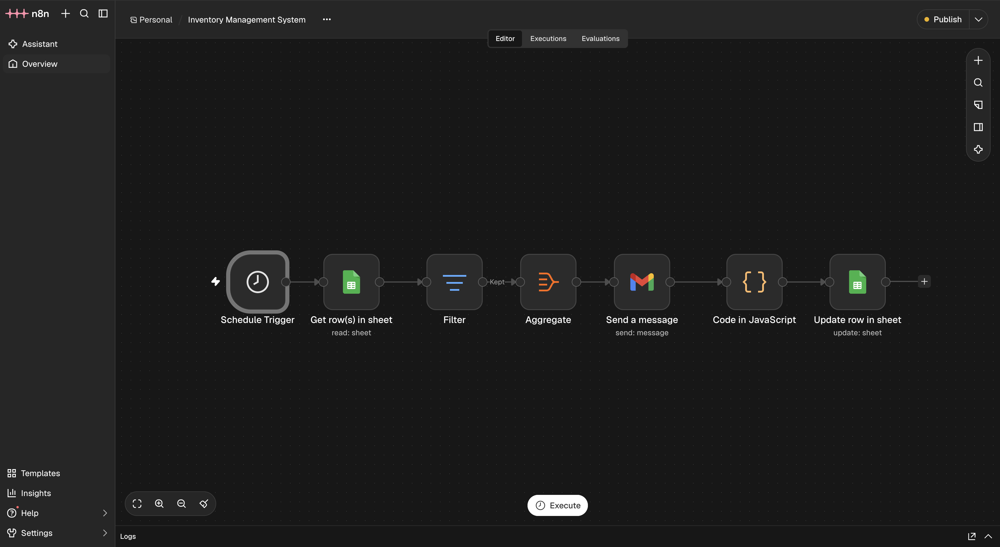

# Inventory Management & Automated Alert System

An automated raw material inventory monitoring and email notification system built with **Google Sheets, n8n, Gmail API, Docker, and JavaScript**.

## Live Dashboard

Explore the inventory management system in Google Sheets, including raw materials, lot tracking, stock movements, automated alerts, and interactive visualizations.

[View Interactive Inventory Dashboard](https://docs.google.com/spreadsheets/d/14km7hxr6Em66WGkihxFUfLWTc4nWNCpidPcmDklfck0/edit?usp=sharing)

## Project Overview

This project demonstrates how spreadsheet-based inventory management and workflow automation can improve stock visibility, monitor inventory risks, and reduce manual notification tasks.

Designed around a fictional dietary supplement manufacturing environment, the system tracks raw materials, inventory lots, stock movements, expiration dates, and inventory alerts.

Google Sheets manages inventory data, calculates stock levels, generates alerts using formulas, and displays key inventory metrics. n8n automates email notifications and updates notification records.

## Key Features

- Raw material inventory management
- Lot-level inventory tracking
- Stock movement registration (IN/OUT)
- Automatic physical and available stock calculations
- Inventory monitoring by material and lot
- Formula-based inventory alert generation
- Low-stock monitoring against minimum stock thresholds
- Expiration-date monitoring
- Identification of blocked and rejected lots
- Interactive inventory dashboard with KPIs and charts
- Automated daily alert processing
- Consolidated email notifications through Gmail
- Automatic notification status updates
- Prevention of repeated notifications for unchanged alert types

## Technologies Used

| Technology | Purpose |
|---|---|
| Google Sheets | Inventory database, formulas, and dashboard |
| n8n | Workflow automation and notification processing |
| Gmail API | Automated email notifications |
| Docker | Local hosting of n8n |
| JavaScript | Processing alert records and notification updates |

## Workflow Architecture



```text
Schedule Trigger (Daily, 8:00 AM)
         ↓
Google Sheets — Read Alerts
         ↓
Filter — New or Changed Alerts
         ↓
Aggregate — Consolidate Alerts
         ↓
Gmail — Send Email
         ↓
JavaScript — Process Alert Records
         ↓
Google Sheets — Update Notification Status
```

## Inventory Structure

The Google Sheets workbook contains five worksheets:

1. **Materials** — Raw material information, suppliers, and minimum stock thresholds
2. **Lots** — Lot identification, expiration dates, status, and stock availability
3. **Movements** — Inventory transactions and stock adjustments
4. **Alerts** — Formula-generated alerts and notification tracking
5. **Dashboard** — Inventory KPIs and interactive charts

## Alert Categories

The system supports the following inventory alerts:

- **Expiring Soon** — Lots approaching their expiration dates
- **Expired** — Lots past their expiration dates
- **Low Stock** — Materials with stock below their defined minimum
- **Blocked** — Lots marked as blocked
- **Rejected** — Lots marked as rejected

## Inventory Dashboard

The dashboard provides six key performance indicators:

- Total Materials
- Total Lots
- Physical Stock
- Available Stock
- Low Stock Materials
- Expiring Lots

It also includes three visualizations:

- Available Stock by Material
- Available Stock vs. Minimum Stock
- Inventory Alerts Distribution

The dashboard uses spreadsheet formulas to update inventory metrics when the underlying records change.

## How It Works

**1. Inventory data management**

Raw materials, lots, and stock movements are maintained in Google Sheets.

**2. Automatic calculations**

Spreadsheet formulas calculate current stock, available stock, and inventory alert conditions.

**3. Scheduled monitoring**

The n8n workflow is configured to execute daily at 8:00 AM.

**4. Alert filtering**

The workflow selects records with a non-empty alert type that differs from the last notified alert type.

**5. Email notifications**

Pending notifications are consolidated into a single email and sent through Gmail.

**6. Notification tracking**

After successful email delivery, the workflow records the notification status and last notified alert type in Google Sheets.

**7. Duplicate prevention**

Unchanged alert types are excluded from subsequent notifications.

## Deployment

The automation runs on a self-hosted n8n instance using Docker.

The current deployment is local, so scheduled execution requires the host computer and n8n service to remain running.

The repository includes a sanitized n8n workflow export. To use it, configure your own:

- Google Sheets credentials and spreadsheet references
- Gmail credentials and recipient email address
- Workflow timezone and schedule

The linked Google Sheets workbook is available as a read-only demonstration.

## Future Improvements

- User-configurable alert thresholds and notification preferences
- Re-notification rules for recurring alerts
- Automatic notification resets when alerts are resolved
- Additional inventory analytics and reporting
- Cloud deployment for continuous execution
- Expanded inventory capacity and dashboard visualizations

## Project Status

**Functional prototype — Portfolio Project**

The system has been tested with new inventory alerts, successful email delivery, notification status updates, and duplicate-notification filtering.

Developed to demonstrate practical skills in **workflow automation, data management, spreadsheet modeling, API integrations, dashboard development, and JavaScript-based data processing**.
